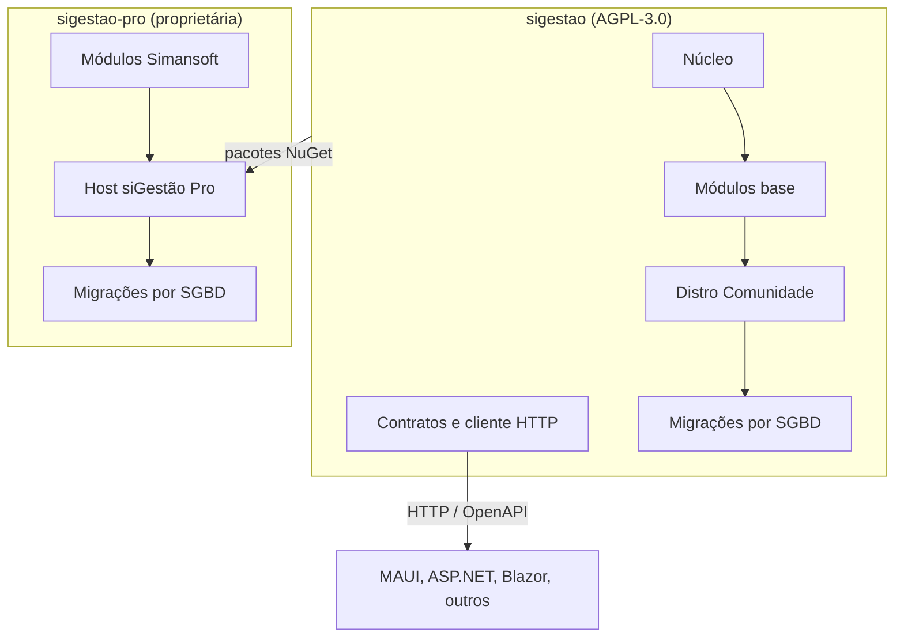

# Visão geral da arquitectura

## O que é

O siGestão é um ERP aberto, escrito em .NET, que fornece uma base de módulos e contratos. As distros compõem essa base com os seus próprios módulos e dão origem aos produtos que se instalam.

## Repositórios

| | `sigestao` | `sigestao-pro` |
|---|---|---|
| Visibilidade | Pública | Privada |
| Produto | siGestão (base e distro Comunidade) | siGestão Pro |
| Licença | AGPL-3.0 | Proprietária |
| Conteúdo | Núcleo, módulos base, contratos, kit de testes | Host da distro, módulos e personalizações da Simansoft, migrações, deploy |
| Depende de | — | Pacotes `Simansoft.SiGestao.*` |

## Módulos

O siGestão é um monólito modular: há um módulo por área de negócio e cada módulo expõe contratos públicos explícitos. O projecto host compõe os módulos em tempo de compilação. Justificação em [ADR 0005](../adr/0005-monolito-modular.md).

## Dados

Há um só modelo de dados. Cada módulo contribui com a configuração do seu modelo, e as migrações vivem na distro, num projecto por provedor. A base inclui uma distro de referência, a Comunidade, usada no CI e em demonstrações. Ver [ADR 0004](../adr/0004-sgbd.md) e [ADR 0007](../adr/0007-migracoes.md).

## Consumidores

A base pode ser usada a partir de qualquer linguagem .NET e de qualquer framework de interface. Regras:

- contratos e cliente HTTP ficam em pacotes sem dependências de interface;
- a API pública dos pacotes segue as regras CLS;
- a API HTTP publica OpenAPI, que serve também consumidores fora do .NET;
- os pacotes visam só `net11.0`; não há suporte para .NET Framework.

Ver [ADR 0011](../adr/0011-interface-e-consumidores.md).

## Diagrama

