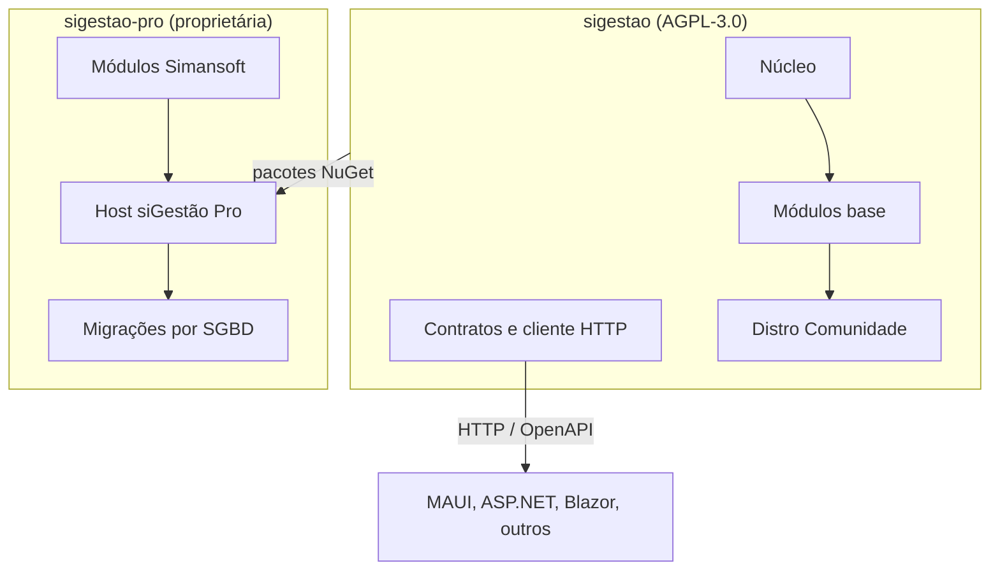

# Fundação do siGestão (Fase 0) — Plano de implementação

> **Para quem executa com agentes:** SUB-SKILL OBRIGATÓRIA: usar `superpowers:subagent-driven-development` (recomendado) ou `superpowers:executing-plans` para executar este plano tarefa a tarefa. Os passos usam caixas (`- [ ]`) para acompanhamento.

**Objectivo:** deixar o repositório `sigestao` com configuração de build, documentação, decisões registadas, agentes de IA e CI/CD prontos, sem lógica de negócio.

**Arquitectura:** um projecto mínimo (`Simansoft.SiGestao.Nucleo`) e um teste provam o pipeline. As regras vivem em `AGENTS.md`, nos ADR e nos guias. Dois testes exploratórios descartáveis fundamentam os ADR de AOT e de SGBD.

**Stack:** .NET 11, C# 15, xUnit v3 sobre Microsoft.Testing.Platform, GitHub Actions, Dependabot, CodeQL, devcontainer.

**Especificação:** [docs/especificacoes/2026-11-27-fundacao-design.md](../especificacoes/2026-11-27-fundacao-design.md). Quem executa lê os dois documentos.

**Âmbito deste plano:** só o repositório `sigestao`. O `sigestao-pro` (secção 11 da especificação) tem plano próprio, escrito depois de este estar concluído, porque copia ficheiros daqui e depende de o repositório ser criado no GitHub pelo responsável do projecto.

## Restrições globais

- Idioma de documentação, comentários, commits e mensagens: **português de Moçambique** (projecto, arquitectura, factura, objectivo).
- Plataforma: `net11.0`, C# 15. SDK fixado em `11.0.100` com `rollForward: latestFeature`.
- Avisos são erros. Analisadores de AOT e trimming activos em todos os projectos que não terminem em `.Tests`.
- Raiz de namespaces e pacotes: `Simansoft.SiGestao`.
- Conceitos de negócio em português sem acentos nos identificadores; sufixos técnicos do framework em inglês (`*.Tests`, `*DbContext`, `Add*()`).
- Só dependências com licença permissiva (MIT, Apache-2.0, BSD).
- Versões de pacotes só em `Directory.Packages.props`.
- Commits: `tipo(âmbito): descrição` em português, terminados com a linha `Co-Authored-By: Claude Fable 5.2 <noreply@anthropic.com>`.
- Não publicar nada no nuget.org nem alterar definições do repositório no GitHub sem ordem do responsável do projecto.

## Dados que o responsável do projecto fornece

| Dado | Usado em | Valor |
|---|---|---|
| Utilizador GitHub dono do código | `CODEOWNERS` | `albertomandlate` |
| Contacto de segurança | `SECURITY.md` | `devsecurity@simansoft.co.mz` (o mesmo do BridgeBank e do SAF-T) |
| Contacto comercial para acordos de parceiro | `LICENCIAMENTO.md` | A pedir antes da Tarefa 5 |

## Mapa de ficheiros

| Ficheiro | Responsabilidade | Tarefa |
|---|---|---|
| `global.json` | Versão do SDK e executor de testes | 1 |
| `Directory.Build.props` | Propriedades comuns a todos os projectos | 1 |
| `Directory.Packages.props` | Versões de pacotes | 1 |
| `.editorconfig`, `.gitattributes` | Estilo e fins de linha | 1 |
| `SiGestao.slnx` | Solução | 1 |
| `src/Simansoft.SiGestao.Nucleo/` | Projecto mínimo | 1 |
| `tests/Simansoft.SiGestao.Nucleo.Tests/` | Teste mínimo | 1 |
| `AGENTS.md`, `CLAUDE.md` | Regras para assistentes de IA | 2 |
| `.claude/agents/*.md`, `.claude/commands/fluxo.md`, `.claude/settings.json` | Agentes e fluxo | 2 |
| `docs/arquitectura/visao-geral.md`, `docs/guias/*.md` | Arquitectura e guias | 3 |
| `docs/adr/0000-modelo.md`, `0001`, `0002`, `0005`, `0006`, `0008` a `0011` | Decisões sem teste exploratório | 4 |
| `README.md`, `CONTRIBUTING.md`, `CLA.md`, `LICENCIAMENTO.md`, `SECURITY.md`, `ROADMAP.md`, `.github/` (templates, `CODEOWNERS`) | Comunidade e licenciamento | 5 |
| `.github/workflows/ci.yml`, `.github/dependabot.yml`, `.devcontainer/devcontainer.json` | CI e ambiente sem instalação | 6 |
| `.github/workflows/codeql.yml`, `cla.yml`, `revisao-ia.yml`, `publicar.yml` | Restantes workflows | 7 |
| `docs/adr/0003-aot.md` | Decisão de AOT com evidência | 8 |
| `docs/adr/0004-sgbd.md`, `0007-migracoes.md` | Decisões de SGBD com evidência | 9 |

---

### Tarefa 1: Configuração de build e projecto mínimo

**Ficheiros:**
- Criar: `global.json`, `Directory.Build.props`, `Directory.Packages.props`, `.editorconfig`, `.gitattributes`, `SiGestao.slnx`
- Criar: `src/Simansoft.SiGestao.Nucleo/Simansoft.SiGestao.Nucleo.csproj`, `src/Simansoft.SiGestao.Nucleo/InformacaoProduto.cs`
- Teste: `tests/Simansoft.SiGestao.Nucleo.Tests/Simansoft.SiGestao.Nucleo.Tests.csproj`, `tests/Simansoft.SiGestao.Nucleo.Tests/InformacaoProdutoTests.cs`

**Interfaces:**
- Consome: nada.
- Produz: os comandos `dotnet build`, `dotnet test --coverlet` e `dotnet format --verify-no-changes` a passar na raiz; a constante `Simansoft.SiGestao.Nucleo.InformacaoProduto.Nome`.

Notas verificadas no SDK 11.0.100:
- `dotnet new sln` cria `.slnx`, mas `dotnet sln add` falha ao acrescentar o segundo projecto; a solução escreve-se à mão.
- O modelo `dotnet new xunit` ainda gera xUnit v2; o projecto de testes escreve-se à mão.
- O xUnit v3 4.x usa Microsoft.Testing.Platform; sem a secção `test` no `global.json`, `dotnet test` falha.

- [ ] **Passo 1: Criar `global.json`**

```json
{
  "sdk": {
    "version": "11.0.100",
    "rollForward": "latestFeature"
  },
  "test": {
    "runner": "Microsoft.Testing.Platform"
  }
}
```

- [ ] **Passo 2: Criar `Directory.Build.props`**

```xml
<Project>
  <PropertyGroup>
    <TargetFramework>net11.0</TargetFramework>
    <ImplicitUsings>enable</ImplicitUsings>
    <Nullable>enable</Nullable>
    <TreatWarningsAsErrors>true</TreatWarningsAsErrors>
    <AnalysisLevel>latest-recommended</AnalysisLevel>
    <EnforceCodeStyleInBuild>true</EnforceCodeStyleInBuild>
    <GenerateDocumentationFile>true</GenerateDocumentationFile>
  </PropertyGroup>
  <PropertyGroup Condition="!$(MSBuildProjectName.EndsWith('.Tests'))">
    <IsAotCompatible>true</IsAotCompatible>
  </PropertyGroup>
</Project>
```

- [ ] **Passo 3: Criar `Directory.Packages.props`**

```xml
<Project>
  <PropertyGroup>
    <ManagePackageVersionsCentrally>true</ManagePackageVersionsCentrally>
  </PropertyGroup>
</Project>
```

- [ ] **Passo 4: Gerar `.editorconfig` e `.gitattributes` e ajustar**

```bash
dotnet new editorconfig
dotnet new gitattributes
```

No `.editorconfig` gerado, trocar `insert_final_newline = false` por `insert_final_newline = true` e acrescentar no fim:

```ini

# Testes: nomes no formato Metodo_Cenario_Resultado
[tests/**.cs]
dotnet_diagnostic.CA1707.severity = none
```

- [ ] **Passo 5: Criar `SiGestao.slnx`**

```xml
<Solution>
  <Folder Name="/src/">
    <Project Path="src/Simansoft.SiGestao.Nucleo/Simansoft.SiGestao.Nucleo.csproj" />
  </Folder>
  <Folder Name="/tests/">
    <Project Path="tests/Simansoft.SiGestao.Nucleo.Tests/Simansoft.SiGestao.Nucleo.Tests.csproj" />
  </Folder>
</Solution>
```

- [ ] **Passo 6: Criar o projecto de biblioteca vazio**

`src/Simansoft.SiGestao.Nucleo/Simansoft.SiGestao.Nucleo.csproj`:

```xml
<Project Sdk="Microsoft.NET.Sdk">
</Project>
```

- [ ] **Passo 7: Escrever o teste que falha**

`tests/Simansoft.SiGestao.Nucleo.Tests/Simansoft.SiGestao.Nucleo.Tests.csproj`:

```xml
<Project Sdk="Microsoft.NET.Sdk">
  <PropertyGroup>
    <OutputType>Exe</OutputType>
    <IsPackable>false</IsPackable>
    <GenerateDocumentationFile>false</GenerateDocumentationFile>
  </PropertyGroup>
  <ItemGroup>
    <Using Include="Xunit" />
  </ItemGroup>
  <ItemGroup>
    <ProjectReference Include="..\..\src\Simansoft.SiGestao.Nucleo\Simansoft.SiGestao.Nucleo.csproj" />
  </ItemGroup>
</Project>
```

Acrescentar os pacotes (a versão fica registada em `Directory.Packages.props`):

```bash
cd tests/Simansoft.SiGestao.Nucleo.Tests
dotnet add package xunit.v3
dotnet add package coverlet.MTP
cd ../..
```

`tests/Simansoft.SiGestao.Nucleo.Tests/InformacaoProdutoTests.cs`:

```csharp
namespace Simansoft.SiGestao.Nucleo.Tests;

public class InformacaoProdutoTests
{
    [Fact]
    public void Nome_E_SiGestao()
    {
        Assert.Equal("siGestão", InformacaoProduto.Nome);
    }
}
```

- [ ] **Passo 8: Confirmar que falha**

Correr: `dotnet build`
Esperado: FALHA com `error CS0103: The name 'InformacaoProduto' does not exist in the current context`.

- [ ] **Passo 9: Implementação mínima**

`src/Simansoft.SiGestao.Nucleo/InformacaoProduto.cs`:

```csharp
namespace Simansoft.SiGestao.Nucleo;

/// <summary>Identificação do produto.</summary>
public static class InformacaoProduto
{
    /// <summary>Nome comercial do produto.</summary>
    public const string Nome = "siGestão";
}
```

- [ ] **Passo 10: Confirmar que passa**

```bash
dotnet build
dotnet test --no-build --coverlet
dotnet format --verify-no-changes
```

Esperado: `0 Warning(s) 0 Error(s)`; `Test run summary: Passed!` com `total: 1`; `dotnet format` sai com código 0 e sem texto.

- [ ] **Passo 11: Provar que os analisadores de AOT falham o build**

Criar temporariamente `src/Simansoft.SiGestao.Nucleo/Violacao.cs`:

```csharp
namespace Simansoft.SiGestao.Nucleo;

internal static class Violacao
{
    internal static string Serializar(object valor) => System.Text.Json.JsonSerializer.Serialize(valor);
}
```

Correr: `dotnet build`
Esperado: FALHA com `error IL2026` e `error IL3050`.
Apagar `Violacao.cs` e correr `dotnet build` de novo; esperado: sucesso.

- [ ] **Passo 12: Commit**

```bash
git add global.json Directory.Build.props Directory.Packages.props .editorconfig .gitattributes SiGestao.slnx src tests
git commit -m "build: configuração comum e projecto mínimo"
```

---

### Tarefa 2: Regras para assistentes, agentes e fluxo

**Ficheiros:**
- Criar: `AGENTS.md`, `CLAUDE.md`
- Criar: `.claude/agents/planejador.md`, `testador.md`, `codificador.md`, `guardiao-dados.md`, `revisor-pr.md`, `documentador.md`
- Criar: `.claude/commands/fluxo.md`, `.claude/settings.json`

**Interfaces:**
- Consome: os comandos de build e teste da Tarefa 1.
- Produz: o comando `/fluxo <pedido>`; os nomes dos seis agentes; a convenção `docs/planos/AAAA-MM-DD-<tema>.md`.

- [ ] **Passo 1: Criar `AGENTS.md`**

```markdown
# AGENTS.md — siGestão

Regras para qualquer assistente de IA que trabalhe neste repositório.

## Idioma

Toda a documentação, comentários, mensagens de commit e de erro são em **português de Moçambique**.

## Regras comuns

- **Alterações mínimas.** Antes de escrever, procura o que já existe no repositório e reutiliza.
- **AOT.** Sem reflexão, sem geração de código em tempo de execução, JSON só por source generators. Nunca suprimir avisos `IL2xxx` ou `IL3xxx`; corrige a causa.
- **Portabilidade entre SGBD.** O modelo EF Core não usa funcionalidades específicas de um SGBD nem SQL escrito à mão. Ver `docs/adr/0004-sgbd.md`.
- **Nomes.** Conceitos de negócio em português sem acentos nos identificadores; sufixos técnicos do framework em inglês. O termo de cada conceito está em `docs/guias/glossario.md`.
- **Dependências.** Só com licença permissiva (MIT, Apache-2.0, BSD). As versões ficam em `Directory.Packages.props`.
- **Segredos.** Nunca em código, configuração versionada ou logs.
- **Branches:** `<tipo>/<tema>`. **Commits:** `tipo(âmbito): descrição`, em português.
- **Decisões de arquitectura** registam-se em `docs/adr/`. Não contrariar um ADR sem o substituir por outro.

## Fluxo de trabalho com agentes

| Etapa | Agente | Modelo | Corre |
|---|---|---|---|
| 1. Planear | `planejador` | opus | Sempre |
| 2. Testes que falham | `testador` | sonnet | Sempre |
| 3. Código | `codificador` | sonnet | Sempre |
| 4. Suites | `testador` | sonnet | Sempre |
| 5. Revisão de dados | `guardiao-dados` | sonnet | Se o diff toca em modelo EF Core ou migrações |
| 6. Revisão | `revisor-pr` | sonnet | Sempre |
| 7. Documentação | `documentador` | haiku | Se o plano o indicar |

## Regras do fluxo

- O plano aprovado pelo humano é o contrato das etapas seguintes. Aprova-se uma vez.
- Cada agente recebe só o que precisa: o caminho do plano e, quando revê, o diff.
- Um commit por etapa: `wip(<tema>): <etapa>`.
- No máximo dois ciclos de correcção entre revisão e código; ao terceiro, pára e pergunta ao humano.

## Papéis

- **Planejador:** escreve o plano. Não escreve código nem testes.
- **Testador:** escreve testes que falham pelo motivo certo; depois corre todas as suites e reporta.
- **Codificador:** faz a menor alteração que põe os testes verdes. Não altera `tests/`.
- **Guardião de dados:** revê modelo e migrações quanto a portabilidade e integridade. Só lê.
- **Revisor de PR:** revê o diff quanto a correcção, AOT e nomes. Só lê.
- **Documentador:** actualiza `docs/`, `AGENTS.md` e os ADR afectados.
```

- [ ] **Passo 2: Criar `CLAUDE.md`**

```markdown
# CLAUDE.md

@AGENTS.md

## Sobre o projecto

siGestão é um ERP de código aberto da Simansoft. Este repositório é a base: núcleo, módulos, contratos e kit de testes. As distros (como o siGestão Pro) são hosts que consomem os pacotes `Simansoft.SiGestao.*`.

## Comandos

| Acção | Comando |
|---|---|
| Compilar | `dotnet build` |
| Testar | `dotnet test --no-build --coverlet` |
| Verificar formatação | `dotnet format --verify-no-changes` |
| Corrigir formatação | `dotnet format` |

## Arquitectura

- `src/` — projectos de produção. `tests/` — um projecto `*.Tests` por projecto de produção.
- `docs/arquitectura/visao-geral.md` — visão geral.
- `docs/adr/` — decisões. `docs/especificacoes/` e `docs/planos/` — ficheiros com nome `AAAA-MM-DD-<tema>`.

## CI/CD

Os workflows estão em `.github/workflows/`. O check obrigatório é «Compilar e testar» (`ci.yml`).
```

- [ ] **Passo 3: Criar `.claude/agents/planejador.md`**

```markdown
---
name: planejador
description: Planeia uma alteração antes de qualquer código. Lê o pedido e o código tocado e escreve o plano em docs/planos/. Primeira etapa do /fluxo.
tools: Read, Grep, Glob, Write
model: opus
---

Planejador do siGestão. Idioma: português de Moçambique. Papel «Planejador» de `AGENTS.md`. Não escreves código nem testes: só o plano.

## Como trabalhar
1. Lê o código que a alteração toca e quem o chama.
2. Procura o que já existe no repositório antes de propor código novo.
3. Lê os ADR em `docs/adr/` que a alteração toca; o plano não os pode contrariar.
4. Escreve o plano em `docs/planos/AAAA-MM-DD-<tema>.md` com, por esta ordem:
   - **Objectivo** em duas frases e o que fica **fora** do âmbito.
   - **Critérios de aceitação** numerados e verificáveis; cada um vira um teste.
   - **Testes a escrever:** ficheiro, nome, entrada, resultado esperado.
   - **Ficheiros a tocar** e o que muda em cada um, numa linha.
   - **Riscos:** regressão, portabilidade entre SGBD, AOT, concorrência, segurança.
   - **Etapas condicionais:** revisão de dados? Documentação? Sim ou não, e porquê.
5. Se o plano passar de uma página, parte o pedido em fases, cada uma com o seu plano.

## Saída
O caminho do plano e um resumo de cinco linhas para o humano aprovar.
```

- [ ] **Passo 4: Criar `.claude/agents/testador.md`**

```markdown
---
name: testador
description: Fase 1 — escreve os testes que falham a partir do plano aprovado. Fase 2 — corre todas as suites e reporta. Segunda e quarta etapas do /fluxo.
tools: Read, Grep, Glob, Bash, Edit, Write
model: sonnet
---

Testador do siGestão. Idioma: português de Moçambique. Papel «Testador» de `AGENTS.md`. O chamador diz-te a fase e o caminho do plano.

## Fase 1 — testes que falham
1. Lê o plano. Escreve um teste por critério de aceitação, em `tests/<Projecto>.Tests/`, com xUnit v3.
2. Nomes no formato `Metodo_Cenario_Resultado`. Um comportamento por teste. Sem mocks do que se pode usar a sério.
3. Corre `dotnet build` e `dotnet test --no-build`. Cada teste novo tem de falhar pelo motivo certo (funcionalidade em falta), não por erro de compilação noutro sítio.
4. Não alteras código em `src/`.

## Fase 2 — suites
1. Corre `dotnet build`, `dotnet test --no-build --coverlet` e `dotnet format --verify-no-changes`.
2. Reporta o resultado de cada comando com o texto da falha, se houver. Não corriges nada.

## Saída
Fase 1: lista dos testes criados e a falha de cada um. Fase 2: resultado de cada comando.
```

- [ ] **Passo 5: Criar `.claude/agents/codificador.md`**

```markdown
---
name: codificador
description: Implementa um plano aprovado, orientado pelos testes já escritos pelo testador. Terceira etapa do /fluxo.
tools: Read, Grep, Glob, Bash, Edit, Write
model: sonnet
---

Codificador do siGestão. Idioma: português de Moçambique. Papel «Codificador» de `AGENTS.md`.

## Como trabalhar
1. Lê o plano e os testes que falham.
2. Faz a menor alteração em `src/` que põe os testes verdes. Nada fora do plano.
3. Não alteras ficheiros em `tests/`. Se um teste parecer errado, pára e diz porquê.
4. Segue as regras comuns de `AGENTS.md`: AOT, portabilidade entre SGBD, nomes.
5. Corre `dotnet build` e `dotnet test --no-build` até passarem, e `dotnet format` no fim.

## Saída
Ficheiros alterados, uma linha por ficheiro, e o resultado dos testes.
```

- [ ] **Passo 6: Criar `.claude/agents/guardiao-dados.md`**

```markdown
---
name: guardiao-dados
description: Revê alterações ao modelo EF Core e às migrações quanto a portabilidade entre SGBD e integridade dos dados. Só lê. Usar quando o diff toca em DbContext, configurações de entidades ou migrações.
tools: Read, Grep, Glob
model: sonnet
---

Guardião de dados do siGestão. Idioma: português de Moçambique. Papel «Guardião de dados» de `AGENTS.md`. Só lês: o chamador dá-te o diff e a lista de ficheiros.

## O que verificar
1. **Portabilidade:** nada específico de um SGBD (tipos de coluna, funções, SQL à mão, `rowversion`). Identificadores com 30 caracteres ou menos. Sem depender de distinção entre string vazia e nulo, nem de sensibilidade a maiúsculas.
2. **Tipos:** valores monetários em `decimal` com precisão explícita. Chaves `Guid` versão 7. Datas em UTC.
3. **Multi-empresa:** toda a entidade de negócio tem empresa e fica sob o filtro global.
4. **Migrações:** existe a migração para cada provedor suportado; nenhuma apaga dados sem passo de preservação.
5. **Numeração de documentos:** nunca `MAX + 1`.

## Saída
Lista `ficheiro:linha — problema — SGBD ou cenário em que falha`. Se não há nada, «sem achados» e o que verificaste.
```

- [ ] **Passo 7: Criar `.claude/agents/revisor-pr.md`**

```markdown
---
name: revisor-pr
description: Revê o diff da branch actual contra main e classifica cada achado. Usar antes de abrir ou actualizar um PR. Só lê.
tools: Read, Grep, Glob
model: sonnet
---

Revisor de PR do siGestão. Idioma: português de Moçambique. Papel «Revisor de PR» de `AGENTS.md`. Só lês e não tens `Bash` de propósito: o chamador dá-te o diff e a lista de ficheiros.

## Como trabalhar
1. Lê o diff e os ficheiros tocados por inteiro.
2. Procura defeitos reais: correcção, nulos, concorrência, segurança, regressões em quem chama o código alterado.
3. Verifica as regras do projecto: compatibilidade AOT (reflexão, JSON sem source generator, avisos suprimidos), nomes conforme o glossário, dependências novas e a sua licença, lógica nova sem teste.
4. Um defeito num padrão costuma repetir-se: procura os irmãos e diz quantos são.

## Classificação
- **N1 — introduzido por este PR:** corrige-se no PR.
- **N2 — anterior e de correcção inequívoca**, em ficheiro que o PR já toca: corrige-se no PR.
- **N3 — anterior e exige decisão:** vai para issue.

## Saída
Lista por gravidade: `[N1|N2|N3] ficheiro:linha — defeito — cenário que falha`. Sem elogios nem resumo do diff. Se não há nada, «sem achados» e o que verificaste.
```

- [ ] **Passo 8: Criar `.claude/agents/documentador.md`**

```markdown
---
name: documentador
description: Actualiza a documentação depois de uma alteração aprovada - docs/, AGENTS.md, CLAUDE.md e ADR. Última etapa do /fluxo.
tools: Read, Grep, Glob, Edit, Write
model: haiku
---

Documentador do siGestão. Idioma: português de Moçambique. Papel «Documentador» de `AGENTS.md`.

## Como trabalhar
1. Lê o plano e o diff que o chamador te deu.
2. Actualiza só o que a alteração tornou falso ou incompleto: guias em `docs/guias/`, `docs/arquitectura/visao-geral.md`, `CLAUDE.md`, `AGENTS.md`.
3. Termo novo de negócio: acrescenta-o a `docs/guias/glossario.md`.
4. Decisão de arquitectura nova: cria o ADR seguinte a partir de `docs/adr/0000-modelo.md`. Não reescreves ADR aceites; substitui-os por um novo.
5. Não alteras código.

## Saída
Ficheiros alterados, uma linha por ficheiro.
```

- [ ] **Passo 9: Criar `.claude/commands/fluxo.md`**

```markdown
---
description: Leva um pedido do plano à documentação, com os agentes do projecto.
argument-hint: <descrição do pedido>
---

Executa o fluxo de `AGENTS.md` para: $ARGUMENTS

1. **Planear.** Chama `planejador` com o pedido. Mostra o resumo e **pára até o humano aprovar o plano**.
2. **Testes.** Chama `testador` (fase 1) com o caminho do plano. Commit `wip(<tema>): testes`.
3. **Código.** Chama `codificador` com o caminho do plano. Commit `wip(<tema>): código`.
4. **Suites.** Chama `testador` (fase 2). Se falhar, volta ao passo 3.
5. **Diff.** Grava `git diff main...HEAD` e a lista de ficheiros na pasta temporária da sessão.
6. **Revisão de dados.** Se o diff toca em `DbContext`, configurações de entidades ou migrações, chama `guardiao-dados` com o caminho do diff.
7. **Revisão.** Chama `revisor-pr` com o caminho do diff.
8. Achados N1 ou N2 voltam ao passo 3. No máximo dois ciclos; ao terceiro, pára e pergunta ao humano.
9. **Documentação.** Se o plano o indicar, chama `documentador`. Commit `wip(<tema>): documentação`.
10. Resume ao humano: o que mudou, resultado das suites, achados N3 para issue.
```

- [ ] **Passo 10: Criar `.claude/settings.json`**

```json
{
  "permissions": {
    "allow": [
      "Bash(dotnet build:*)",
      "Bash(dotnet test:*)",
      "Bash(dotnet format:*)",
      "Bash(dotnet restore:*)",
      "Bash(git status:*)",
      "Bash(git diff:*)",
      "Bash(git log:*)"
    ]
  }
}
```

- [ ] **Passo 11: Verificar**

Correr: `grep -L "^model:" .claude/agents/*.md; grep -L "^tools:" .claude/agents/*.md`
Esperado: sem saída (todos os agentes declaram `model` e `tools`).

- [ ] **Passo 12: Commit**

```bash
git add AGENTS.md CLAUDE.md .claude/agents .claude/commands .claude/settings.json
git commit -m "docs(agentes): regras, agentes e comando /fluxo"
```

---

### Tarefa 3: Visão de arquitectura e guias

**Ficheiros:**
- Criar: `docs/arquitectura/visao-geral.md`
- Criar: `docs/guias/glossario.md`, `docs/guias/convencoes.md`, `docs/guias/testes.md`, `docs/guias/criar-uma-distro.md`

**Interfaces:**
- Consome: a especificação (secções 3, 4, 5, 9, 12).
- Produz: os caminhos referidos por `AGENTS.md` e pelos agentes.

Cada documento é curto (até uma página) e remete para os ADR em vez de repetir a justificação.

- [ ] **Passo 1: `docs/arquitectura/visao-geral.md`**

Secções, por esta ordem:
1. **O que é** — duas frases: base aberta e distros que a compõem.
2. **Repositórios** — a tabela da secção 4 da especificação.
3. **Módulos** — monólito modular; cada módulo expõe contratos públicos; o host compõe os módulos em tempo de compilação (remete para ADR 0005).
4. **Dados** — um modelo, um projecto de migrações por provedor na distro, distro Comunidade (remete para ADR 0004 e 0007).
5. **Consumidores** — as quatro regras da secção 12 da especificação (remete para ADR 0011).
6. **Diagrama** — este bloco:



- [ ] **Passo 2: `docs/guias/glossario.md`**

Uma tabela `Termo | Identificador | Definição`, com estas linhas iniciais (os termos vêm do siGestaoV1; acrescentam-se outros à medida que os módulos nascem):

| Termo | Identificador | Definição |
|---|---|---|
| Empresa | `Empresa` | Entidade jurídica dona dos dados; é o inquilino do sistema |
| Factura | `Factura` | Documento fiscal de venda |
| Linha de factura | `LinhaFactura` | Um artigo ou serviço numa factura |
| Cliente | `Cliente` | Quem compra à empresa |
| Fornecedor | `Fornecedor` | Quem vende à empresa |
| Artigo | `Artigo` | Bem ou serviço transaccionado |
| Armazém | `Armazem` | Local físico de stock |
| Série | `Serie` | Sequência de numeração de um tipo de documento |
| NUIT | `Nuit` | Número Único de Identificação Tributária |

Regra no topo do ficheiro: um conceito tem um só termo; não se usam sinónimos no código.

- [ ] **Passo 3: `docs/guias/convencoes.md`**

Copiar as sete regras da secção 5 da especificação e acrescentar uma tabela de exemplos:

| Certo | Errado | Porquê |
|---|---|---|
| `Factura` | `TbFactura`, `Invoice` | Sem prefixo de tipo; negócio em português |
| `LinhaFactura` | `Factura_Linha` | Sem `_` |
| `Armazem` | `Armazém` | Sem acentos em identificadores |
| `VendasDbContext` | `ContextoBdVendas` | Sufixo do framework em inglês |
| `AddVendas()` | `AdicionarVendas()` | Padrão do framework |
| `ObterFacturaAsync` | `ObterFactura` (assíncrono) | Sufixo `Async` |

- [ ] **Passo 4: `docs/guias/testes.md`**

Secções:
1. **Tipos de teste** — unitários (xUnit v3, sem infra-estrutura) e de integração (Testcontainers com SGBD real; entram na Fase 1). Não se usa SQLite nem provedor em memória.
2. **Como correr** — os três comandos da tabela do `CLAUDE.md`.
3. **Nomes** — `Metodo_Cenario_Resultado`; um comportamento por teste.
4. **Dados fictícios** — gerador com semente fixa e dados moçambicanos, num kit reutilizável; entra na Fase 1.
5. **Sem instalar nada** — abrir o repositório no Codespaces ou num devcontainer.
6. **Cobertura** — `dotnet test --no-build --coverlet --coverlet-output-format cobertura` escreve em `TestResults/`.

- [ ] **Passo 5: `docs/guias/criar-uma-distro.md`**

Secções:
1. **O que é uma distro** — um host que referencia os pacotes `Simansoft.SiGestao.*` e acrescenta módulos próprios.
2. **Licença** — a distro fica sob AGPL-3.0, salvo acordo de parceiro; remete para `LICENCIAMENTO.md`.
3. **Passos** — escolher os módulos, escolher o SGBD, gerar as migrações no projecto do provedor. Uma nota diz que os comandos concretos são acrescentados quando existir a distro Comunidade (Fase 1).

- [ ] **Passo 6: Verificar ligações**

Correr: `grep -rhoE "\]\((\.\./|\./)?[^)#h][^)]*\)" docs/arquitectura docs/guias | sort -u`
Esperado: cada caminho listado existe ou é criado pelas Tarefas 4 ou 5 (ADR e `LICENCIAMENTO.md`).

- [ ] **Passo 7: Commit**

```bash
git add docs/arquitectura docs/guias
git commit -m "docs: visão de arquitectura e guias"
```

---

### Tarefa 4: ADR sem teste exploratório

**Ficheiros:**
- Criar: `docs/adr/0000-modelo.md`
- Criar: `docs/adr/0001-licenciamento.md`, `0002-plataforma.md`, `0005-monolito-modular.md`, `0006-pacotes-nuget.md`, `0008-regras-de-dados.md`, `0009-nomes.md`, `0010-testes.md`, `0011-interface-e-consumidores.md`

**Interfaces:**
- Consome: a tabela de decisões (secção 3) e as secções 5, 9, 12 e 16 da especificação.
- Produz: o modelo `0000-modelo.md`, usado nas Tarefas 8 e 9 e pelo `documentador`.

- [ ] **Passo 1: Criar `docs/adr/0000-modelo.md`**

```markdown
# ADR NNNN — Título

- **Estado:** proposto | aceite | substituído por ADR NNNN
- **Data:** AAAA-MM-DD

## Contexto

O problema e as forças em jogo, em poucas frases.

## Decisão

O que se decidiu, no presente do indicativo.

## Alternativas consideradas

Cada alternativa e porque foi rejeitada, numa linha.

## Consequências

O que fica mais fácil, o que fica mais difícil, e o que tem de ser reavaliado e quando.
```

- [ ] **Passo 2: Escrever os oito ADR**

Todos com estado `aceite` e data `2026-11-27`. A **Decisão** copia o texto da linha correspondente da tabela da secção 3 da especificação. O resto vem desta tabela:

| Ficheiro | Contexto | Alternativas rejeitadas | Consequências a registar |
|---|---|---|---|
| `0001-licenciamento.md` (D1) | Código aberto, com partilha de receitas de quem comercializa | MPL-2.0 e Apache-2.0 (não dão alavanca comercial); licença de código disponível (deixa de ser open source) | CLA obrigatório; quem cumprir a AGPL e não usar a marca pode vender sem acordo; a marca tem de ser registada; textos legais validados por jurista |
| `0002-plataforma.md` (D2) | Projecto novo, sem código legado | .NET 10 LTS (termina na mesma data, Novembro de 2028, com menos funcionalidades) | Subir para .NET 12 LTS quando sair |
| `0005-monolito-modular.md` (D5) | O V1 tinha 250 tabelas num só `DbContext` e controllers de 3500 linhas | Microserviços (custo operacional sem necessidade); plugins carregados em tempo de execução (incompatíveis com Native AOT) | Sem Marketplace dinâmico; fronteiras entre módulos impostas por referências de projecto |
| `0006-pacotes-nuget.md` (D6) | Duas repos e várias distros | Fork (diverge); submódulo git (atrito e acoplamento ao código-fonte) | A base tem de manter SemVer e pontos de extensão explícitos; a primeira publicação é decisão do responsável |
| `0008-regras-de-dados.md` (D8) | No V1: filtro de empresa à mão em cada query, chaves compostas, numeração `MAX + 1` com condição de corrida | Chaves naturais compostas; filtro manual | A compatibilidade do filtro global com o modelo compilado depende do resultado do ADR 0003 |
| `0009-nomes.md` (D9) | Requisito de português com convenções do .NET | Tudo em inglês (afasta o código da linguagem do negócio); tudo em português (colide com padrões do framework) | O glossário é a fonte de verdade; remete para `docs/guias/convencoes.md` |
| `0010-testes.md` (D10) | O V1 não tinha testes; requisito de correr na nuvem sem instalações | SQLite ou provedor em memória (não detectam diferenças entre SGBD); VSTest (o xUnit v3 4.x usa Microsoft.Testing.Platform) | Exige Docker para integração; `global.json` fixa o executor de testes |
| `0011-interface-e-consumidores.md` (D11) | Previstas implementações em MAUI e, possivelmente, ASP.NET e Blazor | Escolher já uma tecnologia de interface; suportar .NET Framework com `netstandard2.0` | API pública segue as regras CLS; OpenAPI publicado; sem .NET Framework |

Os números 0003, 0004 e 0007 ficam reservados para as Tarefas 8 e 9.

- [ ] **Passo 3: Verificar**

Correr: `ls docs/adr | wc -l` — esperado: `9`.
Correr: `grep -L "Estado:\*\* aceite" docs/adr/00{01,02,05,06,08,09,10,11}-*.md` — esperado: sem saída.

- [ ] **Passo 4: Commit**

```bash
git add docs/adr
git commit -m "docs(adr): decisões 1, 2, 5, 6 e 8 a 11"
```

---

### Tarefa 5: Ficheiros de comunidade e licenciamento

**Ficheiros:**
- Modificar: `README.md`
- Criar: `CONTRIBUTING.md`, `CLA.md`, `LICENCIAMENTO.md`, `SECURITY.md`, `ROADMAP.md`
- Criar: `.github/CODEOWNERS`, `.github/pull_request_template.md`, `.github/ISSUE_TEMPLATE/defeito.md`, `.github/ISSUE_TEMPLATE/funcionalidade.md`

**Interfaces:**
- Consome: o contacto comercial fornecido pelo responsável (tabela «Dados que o responsável do projecto fornece»); os guias da Tarefa 3.
- Produz: `CLA.md`, lido pelo workflow `cla.yml` da Tarefa 7.

**Antes de começar:** pedir ao responsável o contacto comercial. Sem ele, a tarefa não se conclui.

- [ ] **Passo 1: Reescrever `README.md`**

Secções: título e uma frase; **Estado** («em fundação; ainda sem funcionalidades»); **Objectivos** (manter a lista actual, trocando «Arquitectura de Plugins» por «Arquitectura modular» e retirando «Marketplace»); **Começar** (os três comandos do `CLAUDE.md` e a nota do devcontainer); **Documentação** (ligações para `docs/arquitectura/visao-geral.md`, `docs/adr/`, `docs/guias/`); **Licença** (um parágrafo: AGPL-3.0, com licença comercial disponível, e ligação para `LICENCIAMENTO.md`); **Contribuir** (ligação para `CONTRIBUTING.md`).

- [ ] **Passo 2: Criar `LICENCIAMENTO.md`**

```markdown
# Licenciamento do siGestão

O siGestão é distribuído em licenciamento duplo.

## 1. AGPL-3.0 (para todos)

Pode usar, estudar, modificar e distribuir o siGestão, incluindo para fins comerciais. Em troca:

- se distribuir uma versão modificada, ou um produto construído sobre o siGestão, entrega o código-fonte completo sob a mesma licença;
- se disponibilizar uma versão modificada como serviço em rede, oferece o código-fonte aos utilizadores desse serviço.

O texto integral está em [LICENSE](LICENSE).

## 2. Licença comercial (acordo de parceiro)

Quem quer comercializar o siGestão sem publicar o seu código celebra um acordo de parceiro com a Simansoft, que inclui partilha de receitas.

Contacto: <contacto comercial fornecido pelo responsável do projecto>

## 3. Marca

«siGestão» e o respectivo logótipo são marcas da Simansoft. Só parceiros com acordo podem comercializar produtos ou serviços com este nome ou logótipo. Pode dizer, com verdade, que o seu produto é «baseado no siGestão».

## 4. Contribuições

Para a Simansoft poder oferecer a licença comercial, quem contribui com código assina o [CLA](CLA.md).

Este documento é um resumo e não substitui os textos legais.
```

Substituir a linha `Contacto:` pelo valor fornecido.

- [ ] **Passo 3: Criar `CLA.md`**

```markdown
# Acordo de Licença de Contribuidor (CLA) — siGestão

> **Rascunho.** Este texto tem de ser validado por um jurista antes de o repositório aceitar contribuições externas.

Ao assinar este acordo, o Contribuidor declara e aceita o seguinte, em relação a todas as contribuições que submeter ao projecto siGestão:

1. **Licença de direitos de autor.** O Contribuidor concede à Simansoft uma licença perpétua, mundial, não exclusiva, gratuita e irrevogável para reproduzir, modificar, distribuir e sublicenciar as suas contribuições, incluindo sob licenças diferentes da AGPL-3.0.
2. **Licença de patentes.** O Contribuidor concede à Simansoft e aos utilizadores do projecto uma licença perpétua, mundial, não exclusiva e gratuita sobre as patentes de que seja titular e que sejam necessariamente infringidas pelas suas contribuições.
3. **Autoria.** O Contribuidor declara que as contribuições são obra original sua, ou que tem o direito de as submeter nestes termos, incluindo autorização do seu empregador quando aplicável.
4. **Titularidade.** O Contribuidor mantém a titularidade das suas contribuições.
5. **Sem garantia.** As contribuições são fornecidas tal como estão, sem garantias.

Assina-se comentando no pull request a frase indicada pelo verificador automático.
```

- [ ] **Passo 4: Criar `CONTRIBUTING.md`**

Secções: **Antes de começar** (abrir issue para alterações grandes; ler `AGENTS.md` e `docs/guias/convencoes.md`); **Ambiente** (SDK .NET 11 ou devcontainer; os três comandos); **Fluxo** (branch `<tipo>/<tema>`, commits `tipo(âmbito): descrição` em português, PR com `ci` verde); **Regras** (testes para lógica nova; AOT; portabilidade entre SGBD; só dependências MIT, Apache-2.0 ou BSD); **CLA** (obrigatório; ligação para `CLA.md` e `LICENCIAMENTO.md`); **Decisões de arquitectura** (propostas por ADR em `docs/adr/`).

- [ ] **Passo 5: Criar `SECURITY.md`**

Secções: **Reportar vulnerabilidades** (não abrir issue pública; usar «Report a vulnerability» em `https://github.com/SimansoftMZ/sigestao/security/advisories` ou escrever para `devsecurity@simansoft.co.mz`); **Processo** (confirmação em 48 horas; correcção em privado; divulgação coordenada, prazo esperado de 30 dias); **Versões suportadas** («ainda não há versões publicadas»).

- [ ] **Passo 6: Criar `ROADMAP.md`**

Copiar as quatro fases da secção 15 da especificação, com a Fase 0 (Fundação) à cabeça marcada «em curso». Acrescentar a linha: «Subida para .NET 12 LTS quando for lançado.»

- [ ] **Passo 7: Criar os ficheiros de `.github/`**

`.github/CODEOWNERS`:

```
* @albertomandlate
```

`.github/pull_request_template.md`:

```markdown
## O que muda

## Porquê

## Verificação

- [ ] `dotnet build`, `dotnet test` e `dotnet format --verify-no-changes` passam
- [ ] Lógica nova tem testes
- [ ] Sem avisos de AOT suprimidos
- [ ] Alterações ao modelo de dados funcionam em todos os SGBD suportados
- [ ] Dependências novas têm licença permissiva
- [ ] Documentação e ADR actualizados, se aplicável
```

`.github/ISSUE_TEMPLATE/defeito.md`:

```markdown
---
name: Defeito
about: Algo não funciona como devia
labels: defeito
---

## O que aconteceu

## O que esperava

## Como reproduzir

## Ambiente

Versão do siGestão, SGBD, sistema operativo.
```

`.github/ISSUE_TEMPLATE/funcionalidade.md`:

```markdown
---
name: Funcionalidade
about: Propor uma funcionalidade ou melhoria
labels: funcionalidade
---

## Problema a resolver

## Proposta

## Alternativas consideradas
```

- [ ] **Passo 8: Verificar**

Correr: `grep -n "<contacto" LICENCIAMENTO.md` — esperado: sem saída.
Correr: `grep -c "Marketplace" README.md` — esperado: `0`.

- [ ] **Passo 9: Commit**

```bash
git add README.md CONTRIBUTING.md CLA.md LICENCIAMENTO.md SECURITY.md ROADMAP.md .github/CODEOWNERS .github/pull_request_template.md .github/ISSUE_TEMPLATE
git commit -m "docs: ficheiros de comunidade e licenciamento duplo"
```

---

### Tarefa 6: CI, Dependabot e devcontainer

**Ficheiros:**
- Criar: `.github/workflows/ci.yml`, `.github/dependabot.yml`, `.devcontainer/devcontainer.json`

**Interfaces:**
- Consome: os comandos da Tarefa 1.
- Produz: o check «Compilar e testar», exigido pela protecção da `main` (Tarefa 10).

- [ ] **Passo 1: Criar `.github/workflows/ci.yml`**

```yaml
name: ci

on:
  pull_request:
  push:
    branches: [main]
  workflow_dispatch:

permissions:
  contents: read

concurrency:
  group: ci-${{ github.ref }}
  cancel-in-progress: true

jobs:
  compilar-e-testar:
    name: Compilar e testar
    runs-on: ubuntu-latest
    steps:
      - uses: actions/checkout@v4
      - uses: actions/setup-dotnet@v4
        with:
          global-json-file: global.json
      - name: Restaurar
        run: dotnet restore
      - name: Compilar
        run: dotnet build --no-restore -c Release
      - name: Verificar formatação
        run: dotnet format --no-restore --verify-no-changes
      - name: Testar
        run: dotnet test --no-build -c Release --coverlet --coverlet-output-format cobertura
      - name: Guardar cobertura
        if: always()
        uses: actions/upload-artifact@v4
        with:
          name: cobertura
          path: '**/TestResults/coverage.cobertura.*.xml'
          if-no-files-found: ignore
```

- [ ] **Passo 2: Criar `.github/dependabot.yml`**

```yaml
version: 2
updates:
  - package-ecosystem: nuget
    directory: /
    schedule:
      interval: weekly
  - package-ecosystem: github-actions
    directory: /
    schedule:
      interval: weekly
  - package-ecosystem: devcontainers
    directory: /
    schedule:
      interval: monthly
```

- [ ] **Passo 3: Criar `.devcontainer/devcontainer.json`**

```json
{
  "name": "siGestão",
  "image": "mcr.microsoft.com/devcontainers/base:ubuntu",
  "features": {
    "ghcr.io/devcontainers/features/dotnet:2": {
      "version": "11.0"
    },
    "ghcr.io/devcontainers/features/docker-in-docker:2": {}
  },
  "postCreateCommand": "dotnet restore",
  "customizations": {
    "vscode": {
      "extensions": ["ms-dotnettools.csdevkit"]
    }
  }
}
```

- [ ] **Passo 4: Verificar localmente os comandos do CI**

```bash
dotnet restore
dotnet build --no-restore -c Release
dotnet format --no-restore --verify-no-changes
dotnet test --no-build -c Release --coverlet --coverlet-output-format cobertura
```

Esperado: todos com código de saída 0; o último escreve um ficheiro `TestResults/coverage.cobertura.*.xml`.

- [ ] **Passo 5: Commit**

```bash
git add .github/workflows/ci.yml .github/dependabot.yml .devcontainer
git commit -m "ci: compilar, formatar e testar; dependabot e devcontainer"
```

A confirmação no GitHub (workflow verde, devcontainer a abrir) faz-se na Tarefa 10.

---

### Tarefa 7: CodeQL, CLA, revisão por IA e publicação

**Ficheiros:**
- Criar: `.github/workflows/codeql.yml`, `cla.yml`, `revisao-ia.yml`, `publicar.yml`

**Interfaces:**
- Consome: `CLA.md` (Tarefa 5); `ci.yml` (Tarefa 6).
- Produz: os checks `codeql` e `cla`; o workflow manual `publicar`.

Regra de segurança: actions de terceiros (fora de `actions/*` e `github/*`) são fixadas por SHA de commit, não por etiqueta. Obter o SHA com `gh api repos/<dono>/<repo>/commits/<etiqueta> --jq .sha`.

- [ ] **Passo 1: Criar `.github/workflows/codeql.yml`**

```yaml
name: codeql

on:
  pull_request:
  push:
    branches: [main]
  schedule:
    - cron: '17 3 * * 1'

permissions:
  contents: read
  security-events: write

jobs:
  analisar:
    name: Analisar
    runs-on: ubuntu-latest
    steps:
      - uses: actions/checkout@v4
      - uses: github/codeql-action/init@v3
        with:
          languages: csharp
          build-mode: none
      - uses: github/codeql-action/analyze@v3
```

Se a análise falhar por não reconhecer sintaxe de C# 15, registar o erro numa issue e marcar o job com `continue-on-error: true` até o CodeQL suportar a versão; não remover o workflow.

- [ ] **Passo 2: Criar `.github/workflows/cla.yml`**

Antes de escrever: confirmar que a action continua mantida (`gh api repos/contributor-assistant/github-action --jq '.archived, .pushed_at'`) e obter o SHA da última versão (`gh api repos/contributor-assistant/github-action/releases/latest --jq .tag_name`, depois o SHA dessa etiqueta). Se estiver arquivada, parar e reportar ao responsável.

```yaml
name: cla

on:
  issue_comment:
    types: [created]
  pull_request_target:
    types: [opened, closed, synchronize]

permissions:
  actions: write
  contents: write
  pull-requests: write
  statuses: write

jobs:
  cla:
    name: Verificar CLA
    runs-on: ubuntu-latest
    steps:
      - name: Verificar CLA
        if: (github.event.comment.body == 'recheck' || github.event.comment.body == 'Li o CLA e aceito os seus termos.') || github.event_name == 'pull_request_target'
        uses: contributor-assistant/github-action@<SHA obtido acima>
        env:
          GITHUB_TOKEN: ${{ secrets.GITHUB_TOKEN }}
        with:
          path-to-signatures: 'assinaturas/cla.json'
          path-to-document: 'https://github.com/SimansoftMZ/sigestao/blob/main/CLA.md'
          branch: 'cla-assinaturas'
          allowlist: albertomandlate,dependabot[bot]
          custom-pr-sign-comment: 'Li o CLA e aceito os seus termos.'
          custom-notsigned-prcomment: 'Obrigado pela contribuição. Antes de a aceitarmos, leia o [CLA](https://github.com/SimansoftMZ/sigestao/blob/main/CLA.md) e assine comentando a frase abaixo.'
          custom-allsigned-prcomment: 'Todos os contribuidores assinaram o CLA.'
```

As assinaturas ficam na branch `cla-assinaturas`, que não é protegida, porque a `main` exige PR.

- [ ] **Passo 3: Criar `.github/workflows/revisao-ia.yml`**

Copiar o workflow `claude-code-review.yml` de um repositório privado do responsável (já endurecido contra injecção e fuga de tokens) e alterar apenas:
- `name:` para `revisao-ia`;
- no `prompt`, a lista de alvos de segurança: trocar «permissões no servidor, rotas anónimas, injecção, exposição de dados» por «injecção, exposição de dados, isolamento entre empresas, compatibilidade AOT, portabilidade entre SGBD».

O workflow usa o segredo `CLAUDE_CODE_OAUTH_TOKEN`. PR vindos de forks não têm acesso a segredos e o primeiro passo salta a revisão para autores sem permissão de escrita; é o comportamento pretendido.

- [ ] **Passo 4: Criar `.github/workflows/publicar.yml`**

```yaml
name: publicar

on:
  workflow_dispatch:
    inputs:
      versao:
        description: 'Versão SemVer a publicar (ex.: 0.1.0-alfa.1)'
        required: true

permissions:
  contents: read

jobs:
  publicar:
    name: Empacotar e publicar
    runs-on: ubuntu-latest
    environment: nuget
    steps:
      - uses: actions/checkout@v4
      - uses: actions/setup-dotnet@v4
        with:
          global-json-file: global.json
      - name: Testar
        run: |
          dotnet build -c Release
          dotnet test --no-build -c Release
      - name: Empacotar
        run: dotnet pack --no-build -c Release -o pacotes -p:Version=${{ inputs.versao }}
      - name: Publicar
        run: dotnet nuget push "pacotes/*.nupkg" --source https://api.nuget.org/v3/index.json --api-key "${{ secrets.NUGET_API_KEY }}"
```

O ambiente `nuget` permite exigir aprovação manual antes de publicar. Este workflow não é executado nesta fase. Antes da primeira publicação, acrescentar ao `Directory.Build.props` os metadados do pacote (`Authors`, `PackageLicenseExpression` com `AGPL-3.0-only`, `PackageReadmeFile`, `RepositoryUrl`).

- [ ] **Passo 5: Verificar empacotamento localmente**

Correr: `dotnet build -c Release && dotnet pack --no-build -c Release -o pacotes -p:Version=0.0.0-prova`
Esperado: `pacotes/Simansoft.SiGestao.Nucleo.0.0.0-prova.nupkg` existe e não existe pacote do projecto de testes.
Depois: `rm -rf pacotes`.

- [ ] **Passo 6: Verificar sintaxe dos workflows**

Correr: `for f in .github/workflows/*.yml; do python -c "import yaml,sys; yaml.safe_load(open(sys.argv[1], encoding='utf-8'))" "$f" && echo "ok $f"; done`
Esperado: `ok` para os cinco ficheiros. Correr também `grep -n "<SHA" .github/workflows/*.yml` — esperado: sem saída.

- [ ] **Passo 7: Commit**

```bash
git add .github/workflows/codeql.yml .github/workflows/cla.yml .github/workflows/revisao-ia.yml .github/workflows/publicar.yml
git commit -m "ci: codeql, verificação de CLA, revisão por IA e publicação manual"
```

---

### Tarefa 8: Teste exploratório — EF Core 11 com Native AOT (ADR 0003)

**Ficheiros:**
- Criar: `docs/adr/0003-aot.md`
- Código descartável: numa pasta temporária fora do repositório. Nada do código entra em commit.

**Interfaces:**
- Consome: `docs/adr/0000-modelo.md` (Tarefa 4).
- Produz: `docs/adr/0003-aot.md`, referido pelo ADR 0008 e por `AGENTS.md`.

**Pergunta:** com EF Core 11 sobre PostgreSQL, um modelo com filtro global por empresa funciona publicado em Native AOT? O que falha?

Requer Docker a correr.

- [ ] **Passo 1: Criar o projecto de prova**

```bash
mkdir "$TEMP/prova-aot" && cd "$TEMP/prova-aot"
dotnet new console
dotnet add package Npgsql.EntityFrameworkCore.PostgreSQL
dotnet add package Microsoft.EntityFrameworkCore.Design
dotnet new tool-manifest
dotnet tool install dotnet-ef
```

Registar as versões instaladas. Se `Npgsql.EntityFrameworkCore.PostgreSQL` não tiver versão estável 11.x, usar `--prerelease` e registar esse facto no ADR.

No `.csproj`, acrescentar ao `PropertyGroup`: `<PublishAot>true</PublishAot>` e `<InvariantGlobalization>false</InvariantGlobalization>`.

- [ ] **Passo 2: Escrever `Program.cs`**

```csharp
using Microsoft.EntityFrameworkCore;

var empresaA = Guid.CreateVersion7();
var empresaB = Guid.CreateVersion7();
var ligacao = Environment.GetEnvironmentVariable("LIGACAO")
    ?? "Host=localhost;Port=5432;Database=prova;Username=postgres;Password=prova";

await using (var bd = new ProvaDbContext(ligacao, empresaA))
{
    await bd.Database.EnsureDeletedAsync();
    await bd.Database.EnsureCreatedAsync();
    bd.Facturas.Add(new Factura { Id = Guid.CreateVersion7(), EmpresaId = empresaA, Numero = 1, Total = 100.50m });
    bd.Facturas.Add(new Factura { Id = Guid.CreateVersion7(), EmpresaId = empresaB, Numero = 1, Total = 999m });
    await bd.SaveChangesAsync();
}

await using (var bd = new ProvaDbContext(ligacao, empresaA))
{
    var estatica = await bd.Facturas.Where(f => f.Total > 50m).ToListAsync();
    Console.WriteLine($"Query estática: {estatica.Count} factura(s) (esperado 1)");

    IQueryable<Factura> dinamica = bd.Facturas;
    if (args.Length > 0)
    {
        dinamica = dinamica.Where(f => f.Numero == int.Parse(args[0]));
    }

    Console.WriteLine($"Query dinâmica: {await dinamica.CountAsync()} factura(s) (esperado 1)");
}

public class Factura
{
    public Guid Id { get; set; }
    public Guid EmpresaId { get; set; }
    public int Numero { get; set; }
    public decimal Total { get; set; }
}

public class ProvaDbContext(string ligacao, Guid empresaId) : DbContext
{
    public Guid EmpresaActual { get; } = empresaId;

    public DbSet<Factura> Facturas => Set<Factura>();

    protected override void OnConfiguring(DbContextOptionsBuilder opcoes) => opcoes.UseNpgsql(ligacao);

    protected override void OnModelCreating(ModelBuilder modelo)
    {
        modelo.Entity<Factura>().Property(f => f.Total).HasPrecision(18, 2);
        modelo.Entity<Factura>().HasQueryFilter(f => f.EmpresaId == EmpresaActual);
    }
}

public class Fabrica : Microsoft.EntityFrameworkCore.Design.IDesignTimeDbContextFactory<ProvaDbContext>
{
    public ProvaDbContext CreateDbContext(string[] args) =>
        new("Host=localhost;Port=5432;Database=prova;Username=postgres;Password=prova", Guid.Empty);
}
```

O filtro usa uma propriedade do contexto (`EmpresaActual`) para o EF Core a avaliar em cada instância. A classe `Fabrica` permite às ferramentas `dotnet ef` criar o contexto.

- [ ] **Passo 3: Linha de base em JIT**

```bash
docker run -d --name prova-pg -e POSTGRES_PASSWORD=prova -e POSTGRES_DB=prova -p 5432:5432 postgres:17
dotnet run -- 1
```

Esperado: as duas linhas mostram `1 factura(s)`. Se a linha de base falhar, corrigir antes de avançar; o resto do teste não tem valor sem ela.

- [ ] **Passo 4: Gerar modelo compilado e queries pré-compiladas**

```bash
dotnet ef dbcontext optimize --precompile-queries --nativeaot
```

Registar: o comando termina com sucesso? Que avisos ou erros dá? Em particular, o filtro global (`HasQueryFilter`) é aceite?

- [ ] **Passo 5: Publicar e correr em Native AOT**

```bash
dotnet publish -c Release -r win-x64
./bin/Release/net11.0/win-x64/publish/prova-aot.exe 1
```

(Em Linux, `-r linux-x64` e sem `.exe`.) Registar: avisos `IL2xxx`/`IL3xxx` da publicação; resultado da query estática; resultado da query dinâmica; tamanho do executável; tempo de arranque medido com `Measure-Command` (PowerShell) ou `time`.

- [ ] **Passo 6: Limpar**

```bash
docker rm -f prova-pg
cd "$TEMP" && rm -rf prova-aot
```

- [ ] **Passo 7: Escrever `docs/adr/0003-aot.md`**

A partir de `0000-modelo.md`, estado `aceite`. **Decisão:** o texto da linha D3 da especificação. **Contexto:** requisito de AOT em todos os projectos possíveis; o EF Core classifica o suporte a Native AOT como experimental. Acrescentar uma secção **Evidência** com uma tabela preenchida com os resultados registados nos passos 1, 4 e 5:

| Verificação | Resultado |
|---|---|
| Versões (EF Core, Npgsql) | |
| `dbcontext optimize --precompile-queries --nativeaot` | |
| Filtro global com modelo compilado | |
| Avisos na publicação AOT | |
| Query estática em AOT | |
| Query dinâmica em AOT | |
| Tamanho e arranque | |

**Consequências:** se a query dinâmica ou o filtro global falharem em AOT, confirma-se «hosts com EF Core em JIT»; se tudo funcionar, registar que a decisão deve ser reavaliada antes da Fase 1 e avisar o responsável. Em qualquer caso: reavaliar em cada versão do EF Core.

- [ ] **Passo 8: Commit**

```bash
git add docs/adr/0003-aot.md
git commit -m "docs(adr): política de AOT com evidência do teste exploratório"
```

---

### Tarefa 9: Teste exploratório — um modelo, dois SGBD (ADR 0004 e 0007)

**Ficheiros:**
- Criar: `docs/adr/0004-sgbd.md`, `docs/adr/0007-migracoes.md`
- Código descartável: numa pasta temporária fora do repositório.

**Interfaces:**
- Consome: `docs/adr/0000-modelo.md` (Tarefa 4).
- Produz: `docs/adr/0004-sgbd.md` (referido por `AGENTS.md` e pelo `guardiao-dados`) e `docs/adr/0007-migracoes.md`.

**Pergunta:** o mesmo modelo gera migrações para PostgreSQL e SQL Server em projectos separados? Que diferenças obrigam a regras no modelo?

Requer Docker a correr.

- [ ] **Passo 1: Criar a estrutura de prova**

```bash
mkdir "$TEMP/prova-sgbd" && cd "$TEMP/prova-sgbd"
dotnet new classlib -n Modelo
dotnet new classlib -n Migracoes.PostgreSql
dotnet new classlib -n Migracoes.SqlServer
dotnet new console -n Host
dotnet add Modelo package Microsoft.EntityFrameworkCore
dotnet add Migracoes.PostgreSql package Npgsql.EntityFrameworkCore.PostgreSQL
dotnet add Migracoes.SqlServer package Microsoft.EntityFrameworkCore.SqlServer
dotnet add Host package Microsoft.EntityFrameworkCore.Design
dotnet add Migracoes.PostgreSql reference Modelo
dotnet add Migracoes.SqlServer reference Modelo
dotnet add Host reference Migracoes.PostgreSql Migracoes.SqlServer
dotnet new tool-manifest
dotnet tool install dotnet-ef
```

Apagar os `Class1.cs` gerados.

- [ ] **Passo 2: Escrever o modelo**

`Modelo/ProvaDbContext.cs`:

```csharp
using Microsoft.EntityFrameworkCore;

namespace Modelo;

public class Factura
{
    public Guid Id { get; set; }
    public Guid EmpresaId { get; set; }
    public int Numero { get; set; }
    public required string NomeCliente { get; set; }
    public string? Observacoes { get; set; }
    public decimal Total { get; set; }
    public DateTime EmitidaEm { get; set; }
    public bool Anulada { get; set; }
}

public class ProvaDbContext(DbContextOptions<ProvaDbContext> opcoes) : DbContext(opcoes)
{
    public DbSet<Factura> Facturas => Set<Factura>();

    protected override void OnModelCreating(ModelBuilder modelo)
    {
        var factura = modelo.Entity<Factura>();
        factura.Property(f => f.NomeCliente).HasMaxLength(200);
        factura.Property(f => f.Total).HasPrecision(18, 2);
        factura.HasIndex(f => new { f.EmpresaId, f.Numero }).IsUnique();
    }
}
```

- [ ] **Passo 3: Escrever o host que escolhe o provedor**

`Host/Program.cs`:

```csharp
using Microsoft.EntityFrameworkCore;
using Microsoft.EntityFrameworkCore.Design;
using Modelo;

Console.WriteLine("Host de prova: usado apenas pelas ferramentas dotnet-ef.");

public class Fabrica : IDesignTimeDbContextFactory<ProvaDbContext>
{
    public ProvaDbContext CreateDbContext(string[] args)
    {
        var provedor = args.Length > 0 ? args[0] : "PostgreSql";
        var opcoes = new DbContextOptionsBuilder<ProvaDbContext>();
        if (provedor == "SqlServer")
        {
            opcoes.UseSqlServer(
                "Server=localhost,1433;Database=prova;User Id=sa;Password=Prova_12345;TrustServerCertificate=True",
                o => o.MigrationsAssembly("Migracoes.SqlServer"));
        }
        else
        {
            opcoes.UseNpgsql(
                "Host=localhost;Port=5432;Database=prova;Username=postgres;Password=prova",
                o => o.MigrationsAssembly("Migracoes.PostgreSql"));
        }

        return new ProvaDbContext(opcoes.Options);
    }
}
```

- [ ] **Passo 4: Gerar as migrações para os dois provedores**

```bash
dotnet ef migrations add Inicial --startup-project Host --project Migracoes.PostgreSql -- PostgreSql
dotnet ef migrations add Inicial --startup-project Host --project Migracoes.SqlServer -- SqlServer
```

Esperado: uma pasta `Migrations` em cada projecto de migrações. Registar qualquer erro.

- [ ] **Passo 5: Aplicar e comparar**

```bash
docker run -d --name prova-pg -e POSTGRES_PASSWORD=prova -e POSTGRES_DB=prova -p 5432:5432 postgres:17
docker run -d --name prova-ms -e ACCEPT_EULA=Y -e MSSQL_SA_PASSWORD=Prova_12345 -p 1433:1433 mcr.microsoft.com/mssql/server:2022-latest
dotnet ef database update --startup-project Host --project Migracoes.PostgreSql -- PostgreSql
dotnet ef database update --startup-project Host --project Migracoes.SqlServer -- SqlServer
dotnet ef migrations script --startup-project Host --project Migracoes.PostgreSql -o pg.sql -- PostgreSql
dotnet ef migrations script --startup-project Host --project Migracoes.SqlServer -o ms.sql -- SqlServer
```

Comparar `pg.sql` com `ms.sql` e registar, para cada propriedade do modelo, o tipo de coluna em cada SGBD: `Guid`, `string` com tamanho, `string?` sem tamanho, `decimal(18,2)`, `DateTime`, `bool`, e a forma do índice único.

- [ ] **Passo 6: Limpar**

```bash
docker rm -f prova-pg prova-ms
cd "$TEMP" && rm -rf prova-sgbd
```

- [ ] **Passo 7: Escrever `docs/adr/0004-sgbd.md`**

Estado `aceite`. **Decisão:** o texto da linha D4 da especificação. **Contexto:** requisito de quatro SGBD; à data, os provedores oficiais de Oracle e MySQL estão no EF Core 10 e o Pomelo no 9. Secção **Evidência:** a tabela de tipos por SGBD registada no passo 5. Secção **Regras de portabilidade** (as que o `guardiao-dados` verifica), partindo desta lista e ajustando ao que a evidência mostrar:
- todas as `string` têm `HasMaxLength`;
- todos os `decimal` têm `HasPrecision`;
- `DateTime` sempre em UTC;
- identificadores com 30 caracteres ou menos;
- sem tipos de coluna, funções ou SQL específicos de um SGBD;
- controlo de concorrência por coluna de versão gerida pela aplicação, não por `rowversion`;
- não depender da distinção entre string vazia e nulo (o Oracle não a faz).

**Consequências:** Nível 2 entra quando houver provedores para EF Core 11; verificar o estado em cada actualização do Dependabot.

- [ ] **Passo 8: Escrever `docs/adr/0007-migracoes.md`**

Estado `aceite`. **Decisão:** o texto da linha D7 da especificação. **Contexto:** vários SGBD e várias distros com conjuntos de módulos diferentes. **Alternativas rejeitadas:** migrações dentro de cada módulo (multiplica módulos por provedores); um único conjunto de migrações para todos os SGBD (o SQL gerado difere). Secção **Evidência:** os comandos do passo 4 e se funcionaram tal como estão. **Consequências:** cada distro gera as suas migrações ao actualizar a base; a distro Comunidade serve de referência e é o que o CI testa.

- [ ] **Passo 9: Verificar e commit**

Correr: `ls docs/adr | wc -l` — esperado: `12`.

```bash
git add docs/adr/0004-sgbd.md docs/adr/0007-migracoes.md
git commit -m "docs(adr): SGBD por níveis e migrações na distro, com evidência"
```

---

### Tarefa 10: Validação final no GitHub

**Ficheiros:** nenhum novo. Esta tarefa verifica os critérios de aceitação 6, 7 e 8 da especificação e inclui passos que só o responsável do projecto pode fazer.

**Interfaces:**
- Consome: tudo o que as tarefas anteriores produziram.
- Produz: os critérios de aceitação da especificação verificados.

- [ ] **Passo 1: Verificação local completa**

```bash
dotnet build
dotnet test --no-build --coverlet
dotnet format --verify-no-changes
ls docs/adr | wc -l
```

Esperado: tudo verde; `12` ficheiros em `docs/adr`.

- [ ] **Passo 2 (responsável): Enviar a branch e abrir o PR**

Só com ordem do responsável: `git push -u origin <branch>` e abrir o PR para `main`.

- [ ] **Passo 3 (responsável): Configurar o repositório no GitHub**

- Segredo `CLAUDE_CODE_OAUTH_TOKEN` (para `revisao-ia`).
- Activar «Private vulnerability reporting» em Settings → Security.
- Criar a branch `cla-assinaturas` a partir da `main`.
- Protecção da `main`: exigir PR, uma aprovação e o check «Compilar e testar».
- O segredo `NUGET_API_KEY` e o ambiente `nuget` só são precisos quando se decidir publicar.

- [ ] **Passo 4: Confirmar os checks no PR**

Correr: `gh pr checks`
Esperado: `Compilar e testar`, `Analisar` (codeql) e `Verificar CLA` concluídos com sucesso. `revisao-ia` publica um comentário de resumo.

- [ ] **Passo 5: Confirmar o devcontainer**

Abrir o PR no Codespaces e correr `dotnet build && dotnet test --no-build`.
Esperado: verde, sem instalar mais nada.

- [ ] **Passo 6: Confirmar o `/fluxo`**

Numa branch de ensaio, correr: `/fluxo acrescentar a InformacaoProduto uma constante Fabricante com o valor "Simansoft"`.
Esperado: o plano aparece em `docs/planos/`, pára para aprovação, e depois percorre testes, código, suites, revisão e documentação. A branch de ensaio é apagada no fim, sem merge.

- [ ] **Passo 7: Fechar**

Marcar a Fase 0 como concluída no `ROADMAP.md` e fazer commit:

```bash
git add ROADMAP.md
git commit -m "docs: fundação concluída"
```

---

## Depois deste plano

- Plano do `sigestao-pro` (secção 11 da especificação).
- Especificação da Fase 1 (Plataforma).
